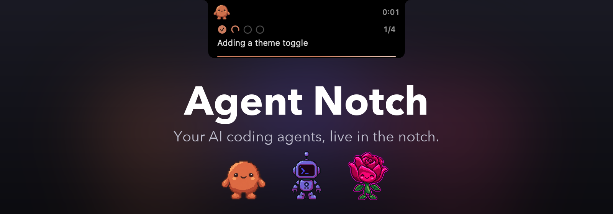
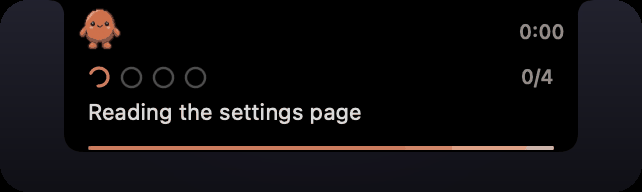
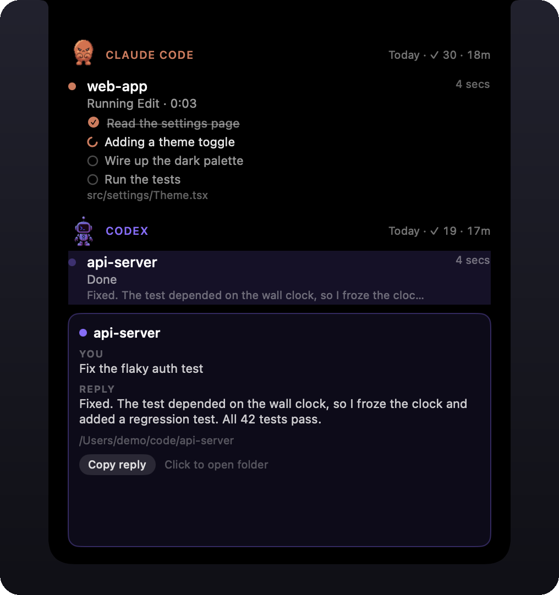
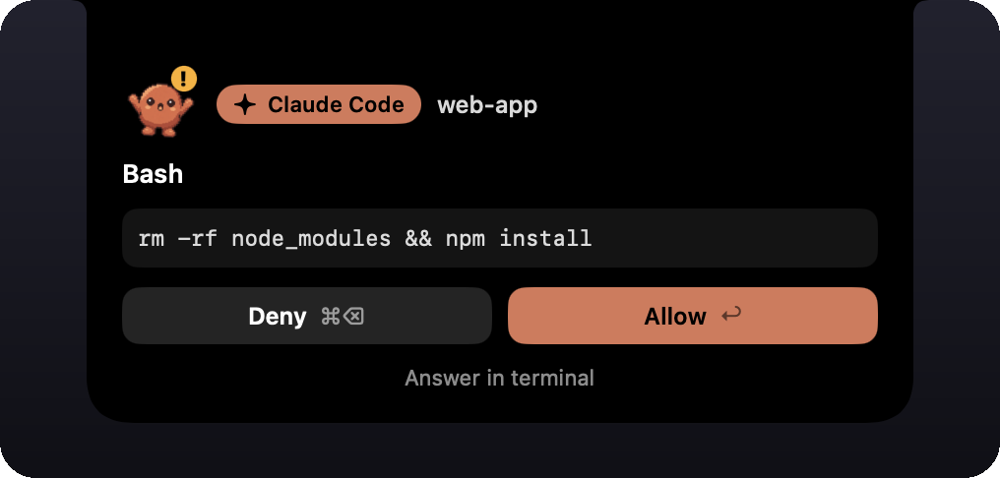
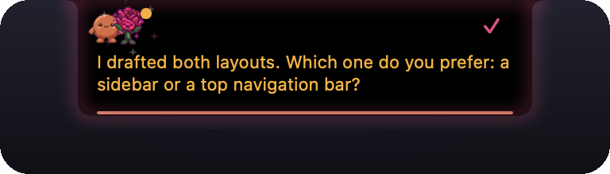
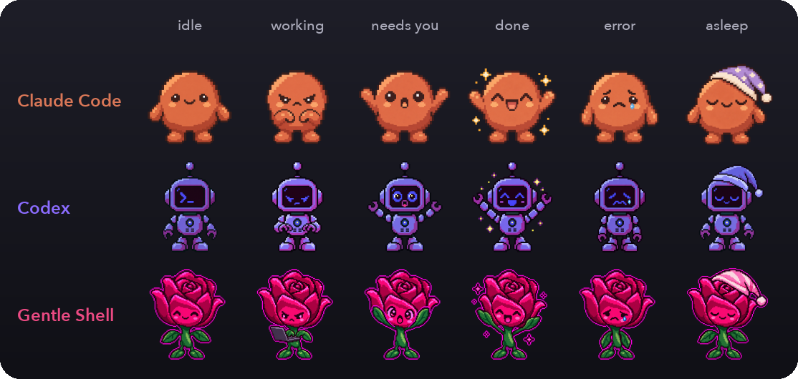
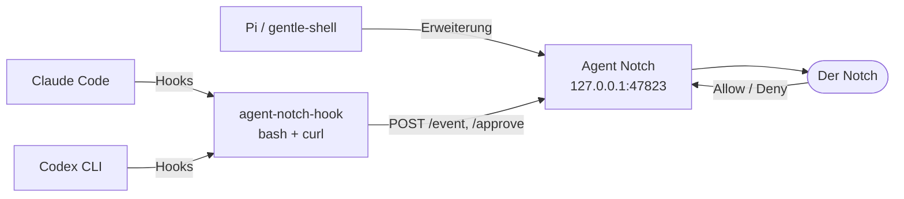

<p align="center">
  
</p>

<p align="center">
  <a href="https://github.com/enderdev01/agent-notch/releases/latest"></a>
  
  
  <a href="LICENSE"></a>
</p>

<p align="center">
  <a href="README.md">English</a> · <a href="README.es.md">Español</a> · <b>Deutsch</b>
</p>

<p align="center">
  <a href="https://github.com/enderdev01/agent-notch/releases/latest"><b>Herunterladen</b></a> ·
  <a href="#funktionen">Funktionen</a> ·
  <a href="#kompatibel-mit">Kompatibel mit</a> ·
  <a href="#installation">Installation</a> ·
  <a href="#so-funktioniert-es">So funktioniert es</a> ·
  <a href="#details">Details</a>
</p>

Agent Notch macht den Notch des MacBooks zu einem Live-Dashboard für Ihre KI-Coding-Agenten. Sie sehen, was jeder Agent gerade tut, verfolgen seine Aufgabenliste Schritt für Schritt und **erlauben oder verweigern** (*Allow / Deny*) Berechtigungsanfragen, ohne Ihre aktuelle Arbeit zu verlassen. Wenn ein Agent fertig ist, sehen Sie seine Antwort; wenn er Sie braucht, sagt der Notch es Ihnen.

Alles läuft lokal, der Server lauscht nur auf `127.0.0.1`, und es werden keine Daten irgendwohin gesendet.

> Die Oberfläche der App ist auf Englisch (Allow, Deny, Copy reply, Your turn …), ebenso die Screenshots. Diese Übersetzung deckt die Dokumentation ab.

## Funktionen

### Die Arbeit Schritt für Schritt verfolgen

Führt ein Agent eine Aufgabenliste, zeigt jeder Schritt einen Ladeindikator, solange er läuft, und ein Häkchen, wenn er erledigt ist, dazu den aktiven Schritt und einen `n/m`-Zähler. Solange der Agent arbeitet, läuft ein Timer.

<p align="center">
  
</p>

### Mit dem Mauszeiger alles sehen

Mit dem Mauszeiger über den Notch fahren, um ihn aufzuklappen: Sitzungen nach Agent gruppiert, die Tagesübersicht pro Agent (abgeschlossene und fehlgeschlagene Durchläufe, gearbeitete Zeit) und für die Zeile unter dem Mauszeiger der vollständige Prompt samt Antwort in einer Karte, die die Liste nie verschiebt. **Copy reply** kopiert die gesamte Antwort. Ein Klick auf eine Zeile springt zum Terminal, in dem der Agent läuft.

<p align="center">
  
</p>

### Direkt im Notch freigeben

Berechtigungsanfragen erscheinen direkt im Notch. **Allow** oder **Deny** per Maus oder Tastatur, oder die Entscheidung an das Terminal zurückgeben. Nichts wird ohne Ihr Zutun entschieden: Passiert nichts, übernimmt nach einem Timeout die eigene Abfrage des Agenten.

<p align="center">
  
</p>

### Wissen, wann Sie dran sind

Einige Sekunden nach dem Ende eines Durchlaufs erscheint unter dem Notch eine lesbare Zeile der letzten Agentenantwort. Stellt diese Antwort eine Frage an Sie, wird sie bernsteinfarben, die Zeile zeigt **Your turn** und das Maskottchen erhält einen bernsteinfarbenen Punkt. Fehler erscheinen rot und in verständlicher Sprache, zum Beispiel „Rate limit reached".

<p align="center">
  
</p>

### Maskottchen mit Stimmungen

Jeder Agent hat ein Pixel-Art-Maskottchen, das auf sein Verhalten reagiert: arbeitet, wartet auf Sie, fertig, fehlgeschlagen sowie schläfrig oder schlafend im Leerlauf.

<p align="center">
  
</p>

## Kompatibel mit

| | Claude Code | Codex CLI | Pi / gentle-shell |
|---|:---:|:---:|:---:|
| Live-Status, Timer und Antwortvorschau | ✅ | ✅ | ✅ |
| Aufgabenliste als Schritte | ✅ `TodoWrite` | ✅ `update_plan` (in echten Läufen nicht getestet) | k. A. |
| Allow / Deny aus dem Notch | ✅ | ✅ | ✅ nur riskante `bash`-Befehle |
| Fehlerzustand | ✅ | k. A. | ✅ |
| Klick fokussiert das Terminal | ✅ exakter Tab in Terminal.app und iTerm2 | ✅ ebenso | ✅ App kommt in den Vordergrund |

Isolierte Pi-Homes (`~/.gentle-shell/agent`, `~/.gentle-dot/agent`) erhalten eine eigene Kopie der Erweiterung, die nur installiert wird, wenn das jeweilige Home existiert.

## Installation

**Voraussetzungen:** macOS 14+. Der Hook-Installer benötigt `jq`: macOS 15 und neuer bringen es mit, unter macOS 14 einmalig `brew install jq` ausführen. Gedacht für MacBooks mit Notch; auf Bildschirmen ohne Notch wird stattdessen eine 200-pt-Pille oben in der Mitte gezeichnet.

1. **[Das DMG herunterladen](https://github.com/enderdev01/agent-notch/releases/latest)** und *Agent Notch* in den Programme-Ordner ziehen.
2. Die App öffnen. Der Build ist **noch nicht notarisiert**, daher blockiert macOS den ersten Start: die App einmal zu öffnen versuchen, dann **Systemeinstellungen → Datenschutz & Sicherheit** öffnen, nach unten zu *Sicherheit* scrollen, **Trotzdem öffnen** (*Open Anyway*) klicken und bestätigen.
3. **Connect** klicken, wenn der erste Start es anbietet, oder später im Menüleistenelement **Connect agents…** wählen. Das trägt die Hooks in Claude Code, Codex und Pi ein und zeigt genau, was sich geändert hat.

   Lieber im Terminal? Derselbe Installer ist in der App enthalten, und `--dry-run` zeigt eine Vorschau der genauen Konfigurationsänderungen:

   ```sh
   "/Applications/Agent Notch.app/Contents/Resources/scripts/install.sh" --dry-run
   "/Applications/Agent Notch.app/Contents/Resources/scripts/install.sh"
   ```

4. Laufende Claude-Code-, Codex- oder Pi-Sitzungen neu starten, damit sie die Hooks laden. Codex fragt möglicherweise, ob den neuen Hooks vertraut werden soll.

`uninstall.sh` (im selben Ordner) entfernt nur Einträge, deren Befehl `agent-notch-hook` enthält, sowie die kopierten Dateien. Konfigurationsdateien werden einmalig als `*.bak-agent-notch` gesichert. Der erste Klick auf eine Zeile fordert die macOS-Berechtigung „Automation" an, die zum Auswählen des Terminal-Tabs dient.

## So funktioniert es



Die Agenten melden Lebenszyklus-Ereignisse an einen kleinen lokalen HTTP-Server. Freigabeanfragen halten die Verbindung offen, bis Sie entscheiden, und die Entscheidung geht im nativen Format des Agenten zurück. Läuft die App nicht, gibt die Bridge nichts aus und beendet sich mit Code 0, sodass die Agenten auf ihre normale Terminal-Abfrage zurückfallen.

## Details

<details>
<summary><b>Einstellungen und Menüleiste</b></summary>

Connect agents… (installiert oder aktualisiert die Hooks), Freigaben pausieren (alles fällt auf das Terminal zurück), Töne für Abschluss und Freigabe, Lautstärke, ob das Maskottchen im Leerlauf angezeigt wird und wie lange es bis zum Einschlafen dauert, wie lange der Zustand „Your turn" bleibt (Off / 2 / 5 / 15 / 30 Minuten), Start bei der Anmeldung (funktioniert nur aus der gepackten `.app`) und Beenden. Änderungen gelten sofort.

`AGENT_NOTCH_REDUCE_MOTION=1` erzwingt zu Testzwecken den Pfad „Bewegung reduzieren".

</details>

<details>
<summary><b>Wie sich jeder Agent einbindet</b></summary>

- **Claude Code**: Hooks in `~/.claude/settings.json` (SessionStart, UserPromptSubmit, PreToolUse, PostToolUse, Notification, Stop, StopFailure -> `event`; PermissionRequest -> `approve`).
- **Codex CLI**: Hooks in `~/.codex/hooks.json` (dieselben ohne Notification und StopFailure, zusätzlich Interrupt).
- **Pi (gentle-shell, Gentle Dot)**: `~/.pi/agent/extensions/agent-notch.ts` meldet Lebenszyklus-Ereignisse und sperrt riskante `bash`-Befehle (rm -rf, sudo, Force-Push, chmod/chown 777, curl|sh, dd, mkfs; die Liste steht am Anfang der Datei).

Entscheidungen werden im nativen Format des Agenten zurückgegeben. Allow/Deny beantworten die Abfrage; „Answer in terminal" (oder ein Timeout nach 110 s) gibt die Kontrolle an die Abfrage des Agenten zurück.

</details>

<details>
<summary><b>Fehlerbehebung</b></summary>

- **App läuft nicht / Port belegt**: `curl http://127.0.0.1:47823/health` prüfen (muss `ok` ausgeben). Der Port lässt sich mit `AGENT_NOTCH_PORT` ändern (App und Agenten müssen übereinstimmen).
- **Es erscheint nichts**: Agentensitzung nach der Installation neu starten; prüfen, ob `~/.local/bin/agent-notch-hook` existiert (**Connect agents…** installiert es). `jq` wird nur zum Verbinden der Agenten benötigt, nicht während sie laufen.
- **Tastaturkürzel**: Return / Cmd-Delete funktionieren, sobald das Panel den Fokus hat (nach einem Klick darauf). Das Panel stiehlt von sich aus nie den Fokus, deshalb werden keine globalen Kürzel registriert.
- **Debug**: Mit `AGENT_NOTCH_DEBUG=1` starten, um `GET /debug/state` und `POST /debug/resolve-all/{allow|deny}` zu aktivieren.

</details>

<details>
<summary><b>Aus dem Quellcode bauen</b></summary>

```sh
make app                          # erzeugt build/Agent Notch.app (Ad-hoc-Signatur)
open "build/Agent Notch.app"      # oder: make run
scripts/install.sh --dry-run
make install
```

Ordner: `Domain/` (Agent, Sitzung, Freigabe, Entscheidung) · `Application/` (SessionStore) · `Infrastructure/` (HTTP-Server, Notch-Panel) · `UI/` (SwiftUI-Notch) · `App/` (Einstiegspunkt, Menüleistenelement).

Die Sprites der Maskottchen liegen in `Sources/AgentNotch/Resources/Mascots/` und werden von `make app` in das Bundle kopiert. Die Rohgrafiken lassen sich mit `scripts/gen-mascots.sh` neu erzeugen (APIMart; der Schlüssel wird aus dem Schlüsselbund-Eintrag `com.onilabs.oni.apimart` gelesen), das App-Symbol mit `scripts/make-icon.py`.

</details>

<details>
<summary><b>Ein Release veröffentlichen</b></summary>

```sh
scripts/release.sh                # build/AgentNotch-<Version>.dmg, Ad-hoc-signiert (nicht notarisiert)

DEVELOPER_ID="Developer ID Application: Ihr Name (TEAMID)" \
NOTARY_PROFILE=agent-notch \
scripts/release.sh                # signiert mit Hardened Runtime, notarisiert und heftet das DMG
```

Zum Veröffentlichen auf GitHub ein Release mit angehängtem DMG und `docs/release-<version>.md` als Beschreibung erstellen (`gh release create v<version> build/AgentNotch-<version>.dmg --title "Agent Notch <version>" --notes-file docs/release-<version>.md`).

Die Notarisierung erfordert ein kostenpflichtiges Apple-Developer-Program-Konto, ein *Developer ID Application*-Zertifikat im Schlüsselbund und ein einmalig gespeichertes Profil mit `xcrun notarytool store-credentials agent-notch --apple-id <id> --team-id <TEAMID> --password <app-spezifisches-Passwort>`. Für jedes Release `CFBundleShortVersionString` in `packaging/Info.plist` erhöhen.

</details>

## Lizenz

MIT, siehe [LICENSE](LICENSE).

Agent Notch ist ein unabhängiges Projekt. Es steht in keiner Verbindung zu Anthropic, OpenAI oder den Projekten Gentleman Programming / Gentle AI und wird von diesen nicht unterstützt; „Claude Code", „Codex" und „gentle" werden nur verwendet, um die eingebundenen Werkzeuge zu benennen. Die Maskottchen sind KI-generierte Pixel-Art (siehe `scripts/gen-mascots.sh`).
