<p align="center">
  
</p>

<p align="center">
  <a href="https://github.com/enderdev01/agent-notch/releases/latest"></a>
  
  
  <a href="LICENSE"></a>
</p>

<p align="center">
  <a href="README.md">English</a> · <b>Español</b> · <a href="README.de.md">Deutsch</a>
</p>

<p align="center">
  <a href="https://github.com/enderdev01/agent-notch/releases/latest"><b>Descargar</b></a> ·
  <a href="#qué-incluye">Qué incluye</a> ·
  <a href="#compatible-con">Compatible con</a> ·
  <a href="#instalación">Instalación</a> ·
  <a href="#cómo-funciona">Cómo funciona</a> ·
  <a href="#detalles">Detalles</a>
</p>

Agent Notch convierte el notch del MacBook en un panel en vivo para tus agentes de programación con IA. Ve qué está haciendo cada agente, sigue su lista de tareas paso a paso y **permite o deniega** las solicitudes de permiso sin salir de lo que estás haciendo. Cuando un agente termina, ves su respuesta; cuando te necesita, el notch te lo indica.

Funciona en local, solo escucha en `127.0.0.1` y no envía nada a ningún sitio.

> La app se muestra en español, inglés o alemán según el idioma del sistema, o el que elijas en el ítem de la barra de menús (Idioma). Las capturas de este README muestran la interfaz en inglés (Allow, Deny, Copy reply, Your turn…); en español son Permitir, Denegar, Copiar respuesta y Tu turno.

## Qué incluye

### Sigue el trabajo, paso a paso

Cuando un agente mantiene una lista de tareas, cada paso muestra un indicador de carga mientras se ejecuta y una marca cuando termina, junto con el paso activo y un contador `n/m`. Un temporizador corre mientras el agente trabaja.

<p align="center">
  
</p>

### Pasa el cursor para ver todo

Pasa el cursor sobre el notch para expandirlo: sesiones agrupadas por agente, el resumen de hoy por agente (turnos terminados, fallidos y tiempo trabajado) y, para la fila bajo el cursor, el prompt y la respuesta completos en una tarjeta que nunca mueve la lista. **Copiar respuesta** copia la respuesta entera. Haz clic en una fila para saltar a la terminal donde corre el agente.

<p align="center">
  
</p>

### Aprueba desde el notch

Las solicitudes de permiso aparecen directamente en el notch. **Permitir** o **Denegar** con el ratón o el teclado, o devuélvelas a la terminal. Nada se decide por ti: si no haces nada, el aviso propio del agente toma el control tras un tiempo de espera.

<p align="center">
  
</p>

### Sabe cuándo te toca

Durante unos segundos después de que termina un turno, una línea legible de la última respuesta del agente aparece bajo el notch. Si esa respuesta te pregunta algo, se vuelve ámbar, la fila dice **Tu turno** y la mascota recibe un punto ámbar. Los fallos muestran un error en lenguaje claro y en rojo, como "Rate limit reached".

<p align="center">
  
</p>

### Mascotas con estados de ánimo

Cada agente tiene una mascota de pixel art que reacciona a lo que hace: trabajando, esperándote, terminado, fallido, y adormilada o dormida cuando está inactivo.

La mascota de Gentle Shell también muestra la fase ODD que el agente reporta con su herramienta `gentle_odd_phase` mientras trabaja: una lupa al explorar o investigar, un foco al autorizar, decidir o planificar, una libreta al verificar y una caja de regalo al cerrar. Al implementar mantiene la pose de trabajo normal. Las fases que Gentle Shell solo infiere por la actividad de sus herramientas no llegan a Agent Notch, así que no cambian la mascota.

<p align="center">
  
</p>

<details>
<summary>Estados de la mascota de Claude Code</summary>

| | Estado | Cuándo |
|---|---|---|
| 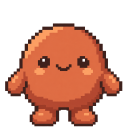 | Despierta | Justo después de actividad; parpadea de vez en cuando. |
| 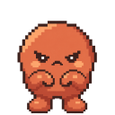 | Trabajando | Hay un turno en curso. Da saltitos. |
| 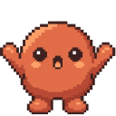 | Te necesita | Espera una aprobación o una respuesta tuya. |
|  | Terminado | El turno terminó; lo celebra. |
|  | Fallido | El turno falló, por ejemplo por un límite de uso. |
| 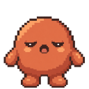 | Adormilada | Lleva un rato inactivo; empieza a cabecear. |
|  | Dormida | Lleva suficiente tiempo inactivo (tú eliges cuánto en el menú). |

</details>

<details>
<summary>Estados de la mascota de Codex</summary>

| | Estado | Cuándo |
|---|---|---|
| 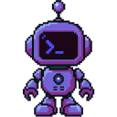 | Despierta | Justo después de actividad; parpadea de vez en cuando. |
|  | Trabajando | Hay un turno en curso. Teclea. |
| 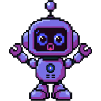 | Te necesita | Espera una aprobación o una respuesta tuya. |
| 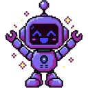 | Terminado | El turno terminó; lo celebra. |
| 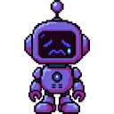 | Fallido | El turno falló, por ejemplo por un límite de uso. |
| 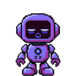 | Adormilada | Lleva un rato inactivo; empieza a cabecear. |
|  | Dormida | Lleva suficiente tiempo inactivo (tú eliges cuánto en el menú). |

</details>

<details>
<summary>Estados de la mascota de Gentle Shell</summary>

| | Estado | Cuándo |
|---|---|---|
|  | Despierta | Justo después de actividad; parpadea de vez en cuando. |
|  | Trabajando | Hay un turno en curso. Se mece como una hoja. |
| 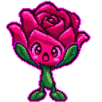 | Te necesita | Espera una aprobación o una respuesta tuya. |
|  | Terminado | El turno terminó; lo celebra. |
|  | Fallido | El turno falló, por ejemplo por un límite de uso. |
|  | Adormilada | Lleva un rato inactivo; empieza a cabecear. |
|  | Dormida | Lleva suficiente tiempo inactivo (tú eliges cuánto en el menú). |

Mientras trabaja, Gentle Shell también muestra la fase que reporta con `gentle_odd_phase`:

| | Fase | Cuándo |
|---|---|---|
| 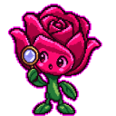 | Exploring, researching | Recorre el código o busca información. |
| 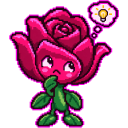 | Authorizing, deciding, planning | Piensa antes de tocar nada. |
| 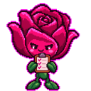 | Checking | Verifica el trabajo. |
|  | Closing | Cierra el turno. |

</details>

## Compatible con

| | Claude Code | Codex CLI | Pi / Gentle Shell |
|---|:---:|:---:|:---:|
| Estado en vivo, temporizador y vista previa de la respuesta | ✅ | ✅ | ✅ |
| Lista de tareas como pasos | ✅ `TodoWrite` | ✅ `update_plan` (sin probar en ejecuciones reales) | n/d |
| Permitir / Denegar desde el notch | ✅ | ✅ | ✅ solo comandos `bash` de riesgo |
| Estado de fallo | ✅ | n/d | ✅ |
| Clic para enfocar la terminal | ✅ pestaña exacta en Terminal.app e iTerm2 | ✅ igual | ✅ la app pasa al frente |

Los homes aislados de Pi (`~/.gentle-shell/agent`, `~/.gentle-dot/agent`) reciben su propia copia de la extensión, que se instala solo si ese home existe.

## Instalación

**Requisitos:** macOS 14+. El instalador de hooks necesita `jq`: macOS 15 y posteriores ya lo incluyen; en macOS 14 ejecuta `brew install jq` una vez. Pensada para MacBooks con notch; en pantallas sin notch dibuja una píldora de 200 pt en la parte superior central.

1. **[Descarga el DMG](https://github.com/enderdev01/agent-notch/releases/latest)** y arrastra *Agent Notch* a Aplicaciones.
2. Ábrela. La compilación **aún no está notarizada**, así que macOS bloquea el primer inicio: intenta abrirla y luego ve a **Ajustes del Sistema → Privacidad y seguridad**, baja hasta *Seguridad*, pulsa **Abrir igualmente** (*Open Anyway*) y confirma.
3. Pulsa **Conectar** cuando el primer arranque lo ofrezca, o elige después **Conectar agentes…** en el ítem de la barra de menús. Añade los hooks a Claude Code, Codex y Pi y muestra exactamente qué cambió.

   ¿Prefieres la terminal? El mismo instalador viene dentro de la app, y `--dry-run` muestra una vista previa de los cambios de configuración:

   ```sh
   "/Applications/Agent Notch.app/Contents/Resources/scripts/install.sh" --dry-run
   "/Applications/Agent Notch.app/Contents/Resources/scripts/install.sh"
   ```

4. Reinicia cualquier sesión de Claude Code / Codex / Pi que esté abierta para que cargue los hooks. Codex puede pedirte que confíes en los hooks nuevos.

`uninstall.sh` (en la misma carpeta) elimina solo las entradas cuyo comando contiene `agent-notch-hook`, además de los archivos copiados. Los archivos de configuración se respaldan una vez como `*.bak-agent-notch`. El primer clic en una fila solicita el permiso de Automatización de macOS, que se usa para seleccionar la pestaña de la terminal.

## Cómo funciona

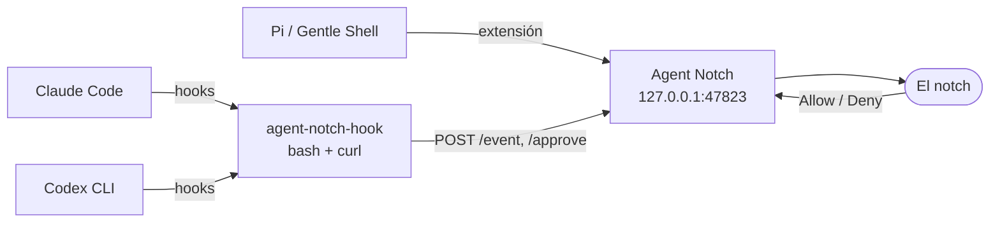

Los agentes reportan eventos de su ciclo de vida a un pequeño servidor HTTP local. Las aprobaciones mantienen la conexión abierta hasta que decides, y la decisión vuelve en el formato nativo del agente. Si la app no está en ejecución, el bridge no imprime nada y sale con código 0, así que los agentes recurren a su aviso normal en la terminal.

## Detalles

<details>
<summary><b>Preferencias y barra de menús</b></summary>

Conectar agentes… (instala o actualiza los hooks), pausar aprobaciones (todo recurre a la terminal), sonidos de fin y de aprobación, volumen, si se muestra la mascota en reposo y cuánto tarda en dormirse, cuánto dura el estado «Tu turno» (Desactivado / 2 / 5 / 15 / 30 minutos), idioma (sigue al sistema salvo que elijas uno; cambiarlo reinicia la app), abrir al iniciar sesión (solo funciona desde la `.app` empaquetada) y salir. Los cambios se aplican al instante.

`AGENT_NOTCH_REDUCE_MOTION=1` fuerza la ruta de Reducir movimiento para pruebas.

</details>

<details>
<summary><b>Cómo se integra cada agente</b></summary>

- **Claude Code**: hooks en `~/.claude/settings.json` (SessionStart, UserPromptSubmit, PreToolUse, PostToolUse, Notification, Stop, StopFailure -> `event`; PermissionRequest -> `approve`).
- **Codex CLI**: hooks en `~/.codex/hooks.json` (los mismos menos Notification y StopFailure, más Interrupt).
- **Pi (Gentle Shell, Gentle Dot)**: `~/.pi/agent/extensions/agent-notch.ts` reporta eventos del ciclo de vida y filtra comandos `bash` de riesgo (rm -rf, sudo, force push, chmod/chown 777, curl|sh, dd, mkfs; edita la lista al inicio del archivo).

Las decisiones se devuelven en el formato nativo del agente. Permitir/Denegar responden al aviso; «Responder en la terminal» (o un tiempo de espera de 110 s) devuelve el control al aviso del propio agente.

</details>

<details>
<summary><b>Solución de problemas</b></summary>

- **La app no está en ejecución / puerto ocupado**: comprueba `curl http://127.0.0.1:47823/health` (debe imprimir `ok`). Cambia el puerto con `AGENT_NOTCH_PORT` (la app y los agentes deben coincidir).
- **No aparece nada**: reinicia la sesión del agente después de instalar; confirma que existe `~/.local/bin/agent-notch-hook` (elige **Conectar agentes…** para instalarlo). `jq` solo hace falta para conectar los agentes, no mientras funcionan.
- **Atajos de teclado**: Return / Cmd-Delete funcionan cuando el panel tiene el foco (tras hacer clic en él). El panel nunca roba el foco por su cuenta, por eso no se registran atajos globales.
- **Depuración**: inicia con `AGENT_NOTCH_DEBUG=1` para habilitar `GET /debug/state` y `POST /debug/resolve-all/{allow|deny}`.

</details>

<details>
<summary><b>Compilar desde el código fuente</b></summary>

```sh
make app                          # genera build/Agent Notch.app (firma ad hoc)
open "build/Agent Notch.app"      # o: make run
scripts/install.sh --dry-run
make install
```

Carpetas: `Domain/` (agente, sesión, aprobación, decisión) · `Application/` (SessionStore) · `Infrastructure/` (servidor HTTP, panel del notch) · `UI/` (notch en SwiftUI) · `App/` (punto de entrada, ítem de la barra de menús).

Los sprites de las mascotas están en `Sources/AgentNotch/Resources/Mascots/` y `make app` los copia al bundle. Regenera el arte original con `scripts/gen-mascots.sh` (APIMart; la clave se lee del ítem de Llavero `com.onilabs.oni.apimart`) y el ícono de la app con `scripts/make-icon.py`.

</details>

<details>
<summary><b>Publicar una versión</b></summary>

```sh
scripts/release.sh                # build/AgentNotch-<versión>.dmg, firma ad hoc (sin notarizar)

DEVELOPER_ID="Developer ID Application: Tu Nombre (TEAMID)" \
NOTARY_PROFILE=agent-notch \
scripts/release.sh                # firma con hardened runtime, notariza y grapa el DMG
```

Para publicar en GitHub, crea un release con el DMG adjunto y `docs/release-<version>.md` como notas (`gh release create v<version> build/AgentNotch-<version>.dmg --title "Agent Notch <version>" --notes-file docs/release-<version>.md`).

La notarización requiere una cuenta de pago del Apple Developer Program, un certificado *Developer ID Application* en tu llavero y un perfil guardado una vez con `xcrun notarytool store-credentials agent-notch --apple-id <id> --team-id <TEAMID>` (te pide la contraseña específica de app con un prompt oculto; la configuración completa está en [docs/notarization.md](docs/notarization.md)). Sube `CFBundleShortVersionString` en `packaging/Info.plist` en cada versión.

</details>

## Licencia

MIT, consulta [LICENSE](LICENSE).

Agent Notch es un proyecto independiente. No está afiliado ni respaldado por Anthropic, OpenAI ni los proyectos Gentleman Programming / Gentle AI; "Claude Code", "Codex" y "gentle" solo se usan para nombrar las herramientas con las que se integra. Las mascotas son pixel art generado con IA (consulta `scripts/gen-mascots.sh`).

<p align="center">
  <a href="https://github.com/Gentleman-Programming/gentle-ai">
    
  </a>
</p>
