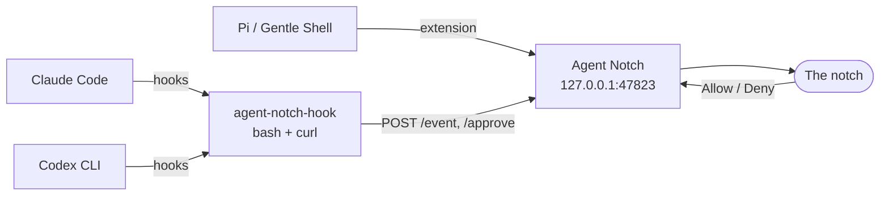

<p align="center">
  
</p>

<p align="center">
  <a href="https://github.com/enderdev01/agent-notch/releases/latest"></a>
  
  
  <a href="LICENSE"></a>
</p>

<p align="center">
  <b>English</b> · <a href="README.es.md">Español</a> · <a href="README.de.md">Deutsch</a>
</p>

<p align="center">
  <a href="https://github.com/enderdev01/agent-notch/releases/latest"><b>Download</b></a> ·
  <a href="#what-you-get">What you get</a> ·
  <a href="#works-with">Works with</a> ·
  <a href="#install">Install</a> ·
  <a href="#how-it-works">How it works</a> ·
  <a href="#details">Details</a>
</p>

Agent Notch turns the MacBook notch into a live dashboard for your AI coding agents. See what each agent is doing, follow its task list step by step, and **Allow / Deny** permission requests without leaving what you are working on. When an agent finishes, you see its answer; when it needs you, the notch says so.

It runs locally, listens only on `127.0.0.1`, and never sends anything anywhere.

## What you get

### Follow the work, step by step

When an agent keeps a task list, every step shows a spinner while it runs and a check when it is done, with the active step and an `n/m` counter. A timer runs while the agent works. Claude desktop MCP tools ending in `__update_plan` can create the list with `items`, then update it with `advance` (finish the running step and start the next pending one), or `done` and `start` (1-based step numbers). Tools ending in `__wrap_up` mark every step done. Incremental changes apply on `PreToolUse` only, so `PostToolUse` does not advance the list again.

<p align="center">
  
</p>

### Hover for the full picture

Hover the notch to expand it: sessions grouped by agent (most recently active agent first, newest sessions first within each group), today's summary per agent (turns finished, failed, time worked), and, for the row under your pointer, the full prompt and reply in a card that never moves the list. **Copy reply** copies the whole answer. Click a row to jump to the terminal the agent runs in.

<p align="center">
  
</p>

### Approve from the notch

Permission requests appear right in the notch. **Allow** or **Deny** with the mouse or the keyboard, or hand it back to the terminal. Nothing is decided on your behalf: if you do nothing, the agent's own prompt takes over after a timeout.

<p align="center">
  
</p>

### Know when it is your turn

For a few seconds after a turn ends, one readable line of the agent's last reply shows under the notch. If that reply asks you something, it turns amber, the row says **Your turn** and the mascot gets an amber dot. Failures show a plain-language error in red, such as "Rate limit reached".

<p align="center">
  
</p>

### Mascots with moods

Each agent has a pixel-art mascot that reacts to what it is doing: working, waiting for you, done, failed, and drowsy or asleep when idle.

Gentle Shell's mascot also shows the ODD phase the agent reports with its `gentle_odd_phase` tool while it works: a magnifying glass when exploring or researching, a lightbulb when authorizing, deciding or planning, a clipboard when checking, and a gift box when closing. Implementing keeps the plain working pose. Phases Gentle Shell only infers from tool activity are not sent to Agent Notch, so they do not change the mascot.

<p align="center">
  
</p>

<details>
<summary>Claude Code mascot states</summary>

| | State | When |
|---|---|---|
|  | Awake | Right after activity; it blinks now and then. |
|  | Working | A turn is running. It hops. |
|  | Needs you | Waiting for an approval or an answer from you. |
|  | Done | The turn finished; it celebrates. |
|  | Failed | The turn failed, for example a rate limit. |
|  | Drowsy | Idle for a while; it starts nodding off. |
|  | Asleep | Idle long enough (you choose how long in the menu). |

</details>

<details>
<summary>Codex mascot states</summary>

| | State | When |
|---|---|---|
|  | Awake | Right after activity; it blinks now and then. |
|  | Working | A turn is running. It types. |
|  | Needs you | Waiting for an approval or an answer from you. |
|  | Done | The turn finished; it celebrates. |
|  | Failed | The turn failed, for example a rate limit. |
|  | Drowsy | Idle for a while; it starts nodding off. |
|  | Asleep | Idle long enough (you choose how long in the menu). |

</details>

<details>
<summary>Gentle Shell mascot states</summary>

| | State | When |
|---|---|---|
|  | Awake | Right after activity; it blinks now and then. |
|  | Working | A turn is running. It sways like a leaf. |
|  | Needs you | Waiting for an approval or an answer from you. |
|  | Done | The turn finished; it celebrates. |
|  | Failed | The turn failed, for example a rate limit. |
|  | Drowsy | Idle for a while; it starts nodding off. |
|  | Asleep | Idle long enough (you choose how long in the menu). |

While it works, Gentle Shell also shows the phase it reports with `gentle_odd_phase`:

| | Phase | When |
|---|---|---|
|  | Exploring, researching | Looking around the code or looking things up. |
|  | Authorizing, deciding, planning | Thinking before touching anything. |
|  | Checking | Verifying the work. |
|  | Closing | Wrapping up the turn. |

</details>

## Works with

| | Claude Code | Codex CLI | Pi / Gentle Shell |
|---|:---:|:---:|:---:|
| Live status, timer and reply peek | ✅ | ✅ | ✅ |
| Task list as steps | ✅ `TodoWrite` | ✅ `update_plan` (untested on real runs) | n/a |
| Allow / Deny from the notch | ✅ | ✅ | ✅ risky `bash` commands only |
| Failure state | ✅ | n/a | ✅ |
| Click to focus the terminal | ✅ exact tab in Terminal.app and iTerm2 | ✅ same | ✅ app comes to front |

Isolated Pi homes (`~/.gentle-shell/agent`, `~/.gentle-dot/agent`) get their own copy of the extension, installed only if that home exists.

## Install

**Requirements:** macOS 14+. The app is available in English, Spanish and German and follows your system language unless you pick one in the menu bar item (Language). The hook installer needs `jq`: macOS 15 and later include it, on macOS 14 run `brew install jq` once. Built for notched MacBooks; on screens without a notch it draws a 200 pt pill at the top center instead.

1. **[Download the DMG](https://github.com/enderdev01/agent-notch/releases/latest)** and drag *Agent Notch* to Applications.
2. Open it. The build is **not notarized yet**, so macOS blocks the first launch: try to open it, then go to **System Settings → Privacy & Security**, scroll down to *Security*, click **Open Anyway** and confirm.
3. Click **Connect** when the first launch offers it, or later choose **Connect agents…** from the menu bar item. It adds the hooks to Claude Code, Codex and Pi and shows exactly what changed.

   Prefer the terminal? The same installer ships inside the app, and `--dry-run` previews the exact config changes:

   ```sh
   "/Applications/Agent Notch.app/Contents/Resources/scripts/install.sh" --dry-run
   "/Applications/Agent Notch.app/Contents/Resources/scripts/install.sh"
   ```

4. Restart any running Claude Code / Codex / Pi session so it picks up the hooks. Codex may ask you to trust the new hooks.

`uninstall.sh` (same folder) removes only the entries whose command contains `agent-notch-hook`, plus the copied files. Config files are backed up once as `*.bak-agent-notch`. The first click on a row asks for the macOS Automation permission, used to select the terminal tab.

## How it works



Agents report lifecycle events to a tiny local HTTP server. Approvals hold the connection open until you decide, and the decision goes back in the agent's native format. If the app is not running, the bridge prints nothing and exits 0, so agents fall back to their normal terminal prompt.

## Details

<details>
<summary><b>Preferences and menu bar</b></summary>

Connect agents… (installs or refreshes the hooks), pause approvals (everything falls back to the terminal), finish and approval sounds, sound volume, whether the idle mascot shows and how long until it falls asleep, how long the "Your turn" state lasts (Off / 2 / 5 / 15 / 30 minutes), language (follows the system unless you pick one; changing it restarts the app), launch at login (only works from the bundled `.app`), and quit. Changes apply immediately.

`AGENT_NOTCH_REDUCE_MOTION=1` forces the Reduce Motion path for testing.

</details>

<details>
<summary><b>How each agent integrates</b></summary>

- **Claude Code**: hooks in `~/.claude/settings.json` (SessionStart, UserPromptSubmit, PreToolUse, PostToolUse, Notification, Stop, StopFailure -> `event`; PermissionRequest -> `approve`).
- **Codex CLI**: hooks in `~/.codex/hooks.json` (same minus Notification and StopFailure, plus Interrupt).
- **Pi (Gentle Shell, Gentle Dot)**: `~/.pi/agent/extensions/agent-notch.ts` reports lifecycle events and gates risky `bash` commands (rm -rf, sudo, force push, chmod/chown 777, curl|sh, dd, mkfs; edit the list at the top of the file).

Decisions are returned in the agent's native format. Allow/Deny answer the prompt; "Answer in terminal" (or a timeout after 110 s) hands control back to the agent's own prompt.

</details>

<details>
<summary><b>Troubleshooting</b></summary>

- **App not running / port busy**: check `curl http://127.0.0.1:47823/health` (should print `ok`). Override the port with `AGENT_NOTCH_PORT` (app and agents must agree).
- **Nothing shows up**: restart the agent session after installing; confirm `~/.local/bin/agent-notch-hook` exists (choose **Connect agents…** to install it). `jq` is only needed to connect agents, not while they run.
- **Keyboard hints**: Return / Cmd-Delete work once the panel has focus (after you click it). The panel never steals focus on its own, so global shortcuts are intentionally not registered.
- **Debug**: launch with `AGENT_NOTCH_DEBUG=1` to enable `GET /debug/state` and `POST /debug/resolve-all/{allow|deny}`.

</details>

<details>
<summary><b>Build from source</b></summary>

```sh
make app                          # builds build/Agent Notch.app (ad-hoc signed)
open "build/Agent Notch.app"      # or: make run
scripts/install.sh --dry-run
make install
```

Folders: `Domain/` (agent, session, approval, decision) · `Application/` (SessionStore) · `Infrastructure/` (HTTP server, notch panel) · `UI/` (SwiftUI notch) · `App/` (entry point, menu bar item).

Mascot sprites live in `Sources/AgentNotch/Resources/Mascots/` and are copied into the app bundle by `make app`. Regenerate the raw art with `scripts/gen-mascots.sh` (APIMart; key read from the Keychain item `com.onilabs.oni.apimart`) and the app icon with `scripts/make-icon.py`.

</details>

<details>
<summary><b>Releasing</b></summary>

```sh
scripts/release.sh                # build/AgentNotch-<version>.dmg, ad-hoc signed (not notarized)

DEVELOPER_ID="Developer ID Application: Your Name (TEAMID)" \
NOTARY_PROFILE=agent-notch \
scripts/release.sh                # signs with the hardened runtime, notarizes and staples the DMG
```

To publish on GitHub, create a release with the DMG attached and `docs/release-<version>.md` as its notes (`gh release create v<version> build/AgentNotch-<version>.dmg --title "Agent Notch <version>" --notes-file docs/release-<version>.md`).

Notarization needs a paid Apple Developer Program account, a *Developer ID Application* certificate in your keychain, and a profile stored once with `xcrun notarytool store-credentials agent-notch --apple-id <id> --team-id <TEAMID>` (it asks for the app-specific password with a hidden prompt; the full setup is in [docs/notarization.md](docs/notarization.md)). Bump `CFBundleShortVersionString` in `packaging/Info.plist` for each release.

</details>

## License

MIT, see [LICENSE](LICENSE).

Agent Notch is an independent project. It is not affiliated with or endorsed by Anthropic, OpenAI, or the Gentleman Programming / Gentle AI projects; "Claude Code", "Codex" and "gentle" are only used to name the tools it integrates with. The mascots are AI-generated pixel art (see `scripts/gen-mascots.sh`).

<p align="center">
  <a href="https://github.com/Gentleman-Programming/gentle-ai">
    
  </a>
</p>
